# CloudNova schema-change pipeline

Takes a schema change from **pull request → staging → one canary region → the remaining regions** on Aurora PostgreSQL, with no maintenance window, no per-region hand-applying and no reviewer-dependent quality.

> **Verification & Fixes Applied.** Executed and verified end-to-end locally (`make test`, `make demo`, `dynamic_check.py`, `make tf-plan`) and in GitHub Actions (`pr-checks.yml`, `deploy.yml` with `dba-approval`, `drift.yml`, `terraform.yml`). Fixed multi-variable `export` syntax in `Makefile`, added PostgreSQL 16 `attidentity::text` casting in `tools/fingerprint.py`, updated `trivy-action` to `v0.36.0` with multi-platform `.terraform.lock.hcl` checksums and local S3 backend overrides for offline Terraform plans (`staging_plan.txt`, `prod_plan.txt`, `global_plan.txt`), and scoped `deploy.yml` waiver approval detection to newly changed migrations. Nothing was `terraform apply`'d and no AWS account was used.

## How it works

```mermaid
flowchart LR
  PR[Pull request<br/>migrations/NNN_x.sql + .down.sql] --> S
  subgraph CI[PR checks - Postgres 16 container]
    S[1 Static lint<br/>R001-R018 + Squawk,<br/>immutability] --> D[2 Rehearsal on seeded DB<br/>rewrite + lock-hold detection<br/>plan snapshot before/after<br/>down→up rollback drill]
  end
  D --> M[merge to main]
  M --> G[Build golden schema<br/>+ re-lint, detect waivers]
  G -->|waiver present| A{{dba-approval<br/>DBRE reviewer}}
  G --> ST
  A --> ST[staging<br/>migrate · verify · bake · drift]
  ST --> C[prod canary eu-west-1<br/>migrate · verify · bake 30s+ · alarms · drift]
  C --> R1[us-east-1] --> R2[ap-southeast-1]
  R2 --> OBS[(Always-on signals<br/>CloudWatch alarms · log_lock_waits<br/>auto_explain · pg_stat_statements)]
  DR[Drift workflow every 6h] -.-> OBS
  C -. fail-fast: later regions never start .-> X[Stop + alert]
```



| Layer | What | Where |
|---|---|---|
| Infra | VPC, Aurora PG16 (writer + readers), KMS, param group, OIDC pipeline role, break-glass role, alarms | `terraform/` |
| Gate (static) | 17 rules over statements + Squawk companion check; per-file waivers | `tools/lint_migration.py`, `pr-checks.yml` |
| Gate (dynamic) | Runs the migration in a txn on 300k seeded rows, detects rewrites via `relfilenode`, measures ACCESS EXCLUSIVE hold, rolls back | `tools/dynamic_check.py` |
| Gate (plans) | `EXPLAIN` of hot queries before/after; fails if a relation that previously used an index degrades to `Seq Scan` or cost > 1.5× | `tools/plan_check.py`, `queries/critical.sql` |
| Apply | DB session advisory lock (`pg_try_advisory_lock`), pre-change snapshot, `lock_timeout` 3s + retry/backoff, checksum checks | `tools/migrate.py`, `scripts/rollout_env.sh` |
| Verify | smoke, INVALID indexes, lock waiters, replica lag, bake loop, CloudWatch alarm gate | `tools/verify.py`, `scripts/rollout_env.sh` |
| Drift | normalised catalog fingerprint vs golden schema | `tools/fingerprint.py`, `drift.yml` |

## Sample migrations (what each one tests)

| File | Verdict | Tests |
|---|---|---|
| `migrations/002_add_orders_notes.sql` | **allowed** | nullable ADD COLUMN: metadata-only |
| `migrations/003_…_idx.sql` | **allowed** | `CREATE INDEX CONCURRENTLY` + `no-transaction` directive + custom statement timeout |
| `migrations/004` + `005` | **allowed** | `CHECK … NOT VALID` then `VALIDATE`: the safe two-step for constraints |
| `tests/bad_migrations/90…99`, `89` | **blocked** (each by the rule named on line 1) | blocking index, type rewrite, drop column, SET NOT NULL, validating FK, volatile default, rename, CONCURRENTLY in txn, unbounded UPDATE, NOT NULL w/o default, missing down |
| `tests/waiver_migrations/100…` | **passes lint, forces DBRE approval** | destructive change with a written reason |

`tests/test_lint.py` asserts all of the above, so the gate is itself tested and cannot silently weaken.

## Run and test

```bash
make test                 # no DB needed: 15 lint assertions + 9 plan-check unit tests
make demo-block           # see the refusal messages
make demo                 # needs Docker: apply → seed → verify → drift → rollback drill → plan check
make tf-plan              # generate offline Terraform plans for staging, prod, and global
```
CI: `pr-checks.yml` (PRs), `deploy.yml` (main), `drift.yml` (cron; Run workflow with *simulate_drift* to watch a hand-made change get caught), `rollback.yml`, `terraform.yml`.
Terraform offline: `cd terraform/envs/staging && terraform init -backend=false && terraform plan -var offline=true`.

**Demo vs AWS mode.** With repo variable `TARGET_MODE` unset, every stage runs against its own Postgres service container (so stages start empty and apply everything; this demonstrates sequencing, gating and checks, not accumulated state). With `TARGET_MODE=aws`, jobs run on VPC-attached runners (`vpc-runners` label), assume the environment's role via OIDC, authenticate with an IAM token and verify TLS. Per-GitHub-Environment variables: `AWS_ROLE_ARN` (from Terraform output), `AWS_REGION`, `DB_HOST`, `DB_CLUSTER_ID`, `ALARM_PREFIX`, `RDS_CA_BUNDLE`. Create GitHub Environments `staging`, `production-canary`, `production-us-east-1`, `production-ap-southeast-1`, `dba-approval` (required reviewers), and `production-*`/`dba-approval` branch protection to `main`. One-time per cluster: a break-glass admin runs `db/bootstrap/roles.sql`.

## Drift
A golden fingerprint is built by applying the repo's migrations to a clean container. Each environment's fingerprint (columns, constraints incl. validity, indexes incl. INVALID, triggers, functions, views, applied versions+checksums) is compared to it after every stage and every 6 hours. Owners, OIDs and column order are excluded so Aurora and a container compare equal. In `aws` mode the drift job must build golden at the live `max(version)` of each region (regions legitimately differ mid-rollout); that branch is stubbed and fails loudly rather than pretending.

More: [DECISIONS](docs/DECISIONS.md) · [ROLLBACK](docs/ROLLBACK.md) · [OBSERVABILITY & on-call](docs/OBSERVABILITY.md)
